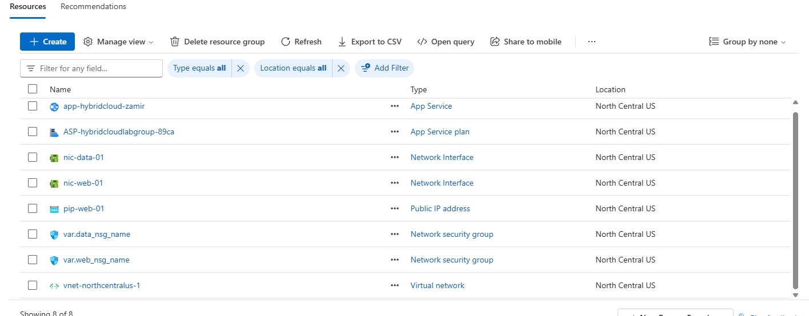

# Architecture

The environment follows a basic 3-tier design with separate web, application, and data layers.

Traffic follows this path:

Internet → Web VM → App Service → PostgreSQL VM

The web tier runs Nginx on an Ubuntu VM and handles incoming web traffic.

The application tier runs through Azure App Service and handles the backend logic. Keeping this separate from the web server gives the backend its own role instead of putting everything on one machine.

The data tier uses a separate Ubuntu VM running PostgreSQL. Keeping the database separate limits what can reach it and keeps it away from direct web traffic.

Traffic between the tiers follows the application flow instead of allowing every resource to communicate freely. The web server does not connect directly to PostgreSQL. Database requests go through the application tier.

The tiers are also placed on separate subnets so their traffic can be controlled independently.
