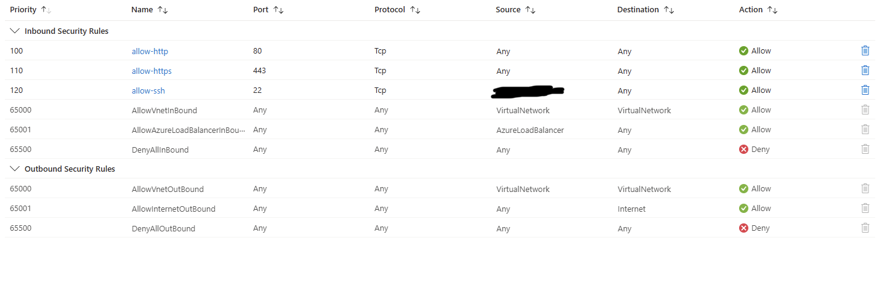
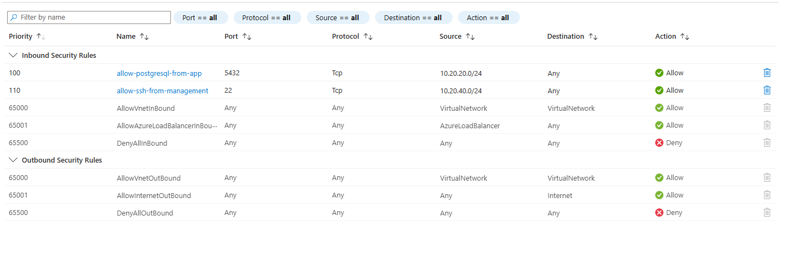

# Network Security

The network rules are set up so each tier only receives the traffic it needs.

The web tier allows HTTP on port 80 and HTTPS on port 443 since it handles incoming web traffic. SSH on port 22 is restricted to a single source address instead of being open to the internet.

 

The data tier is more restricted. PostgreSQL traffic on port 5432 is only allowed from the application subnet at 10.20.20.0/24. SSH is allowed from the management subnet at 10.20.40.0/24.

The database does not need HTTP or HTTPS access, and anything that does not match an allowed rule falls through to Azure's default inbound deny rule.

This keeps the normal traffic path limited to:

Web → App → Data
